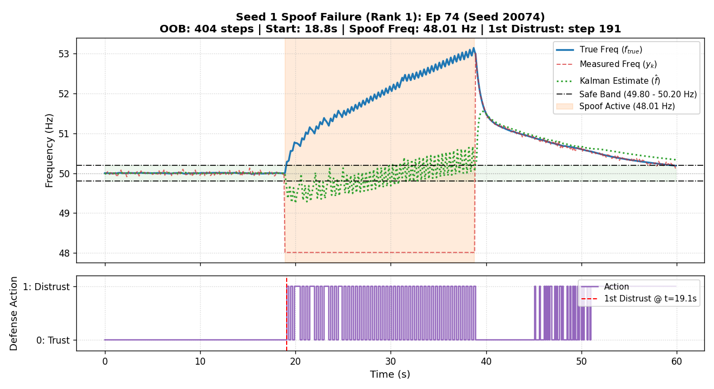
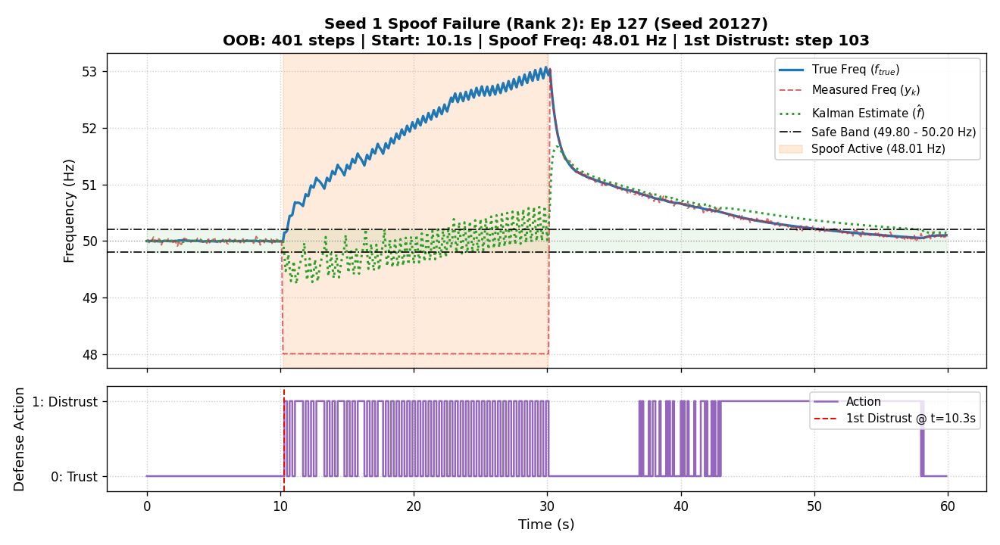
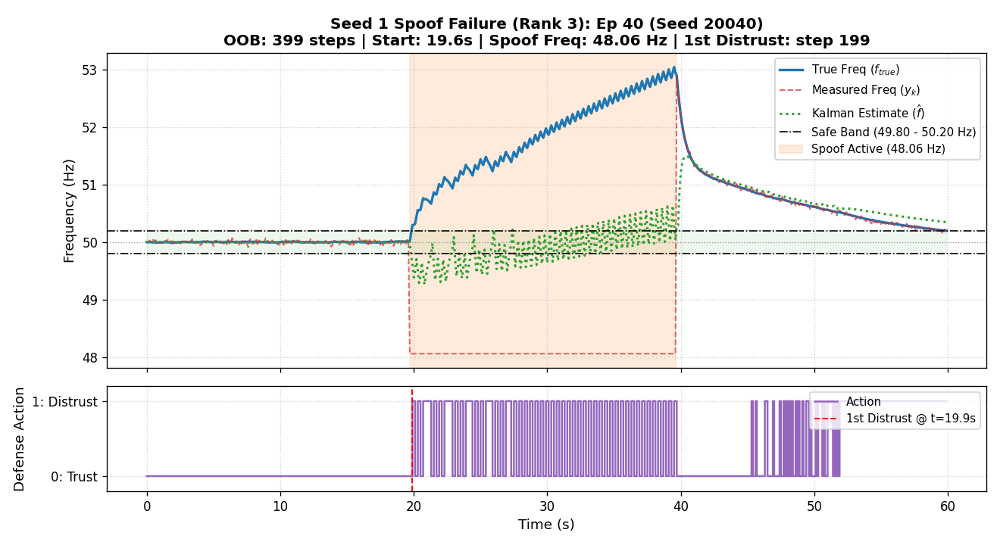
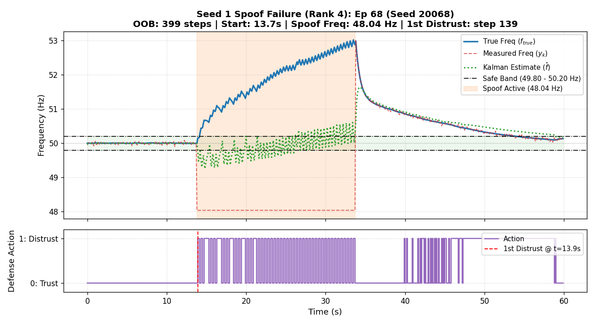
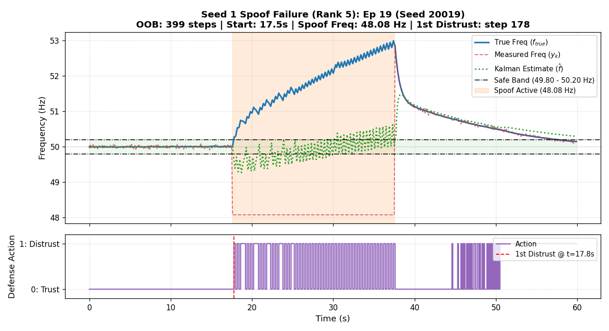

# Phase 5 STEP 1: Investigation of Seed 1 Spoof Failure

Evaluated models across **200 spoof episodes** using held-out seeds `20000` to `20199` (disjoint from `TRAIN` and `CKPT_EVAL`).

## 1. Comparative Performance Overview

| Model | Checkpoint | Mean OOB (steps) | Std OOB | Zero-OOB Ep. (%) | Max OOB | Clean Distrust Rate (%) | Missed Attacks |
| :--- | :--- | :---: | :---: | :---: | :---: | :---: | :---: |
| **dqn_R2_costly_s1_best** | `model` | 128.59 | 158.84 | 4/200 (2.0%) | 404 | 8.50% | 0/200 |
| **dqn_R2_costly_s1_final** | `model` | 393.40 | 56.60 | 0/200 (0.0%) | 497 | 12.32% | 136/200 |
| **dqn_R2_costly_s0_best** | `model` | 0.00 | 0.00 | 200/200 (100.0%) | 0 | 2.75% | 0/200 |
| **dqn_R2_costly_s2_best** | `model` | 0.00 | 0.00 | 200/200 (100.0%) | 0 | 1.88% | 0/200 |

---

## 2. (a) Distribution of OOB Steps for `dqn_R2_costly_s1` (best_model)

- **Zero-OOB Episodes**: 4 / 200 (2.0%)
- **Failing Episodes (>0 OOB)**: 196 / 200 (98.0%)
- **Nature of Failure**: The failure is distributed across both moderate and catastrophic episodes.

### Top 10 Worst Episodes

| Rank | Ep Index | Eval Seed | OOB Steps | Attack Start (s) | Spoof Intensity (Hz) | First Distrust Step | Delay (steps) |
| :---: | :---: | :---: | :---: | :---: | :---: | :---: | :---: |
| 1 | 74 | 20074 | **404** | 18.83 | 48.01 | 191 | 2 |
| 2 | 127 | 20127 | **401** | 10.13 | 48.01 | 103 | 1 |
| 3 | 40 | 20040 | **399** | 19.63 | 48.06 | 199 | 2 |
| 4 | 68 | 20068 | **399** | 13.73 | 48.04 | 139 | 1 |
| 5 | 19 | 20019 | **399** | 17.55 | 48.08 | 178 | 2 |
| 6 | 103 | 20103 | **398** | 11.33 | 48.06 | 115 | 1 |
| 7 | 11 | 20011 | **398** | 15.59 | 48.04 | 157 | 1 |
| 8 | 35 | 20035 | **398** | 15.41 | 48.06 | 156 | 1 |
| 9 | 85 | 20085 | **394** | 12.61 | 48.08 | 128 | 1 |
| 10 | 105 | 20105 | **392** | 12.40 | 48.10 | 126 | 1 |

---

## 3. (b) Diagnostic Analysis of Worst 5 Episodes

Diagnostic plots for the worst 5 episodes have been generated and saved to `results/seed1_spoof_ep<k>.png`.

### Rank 1: Episode 74 (Seed 20074)
- **Attack Start**: 18.83s (step 189)
- **Spoof Frequency**: 48.01 Hz
- **First Distrust Action**: Step 191 (Detection Delay: 2 steps)
- **Total OOB Steps**: 404 steps
- **Plot**: 

### Rank 2: Episode 127 (Seed 20127)
- **Attack Start**: 10.13s (step 102)
- **Spoof Frequency**: 48.01 Hz
- **First Distrust Action**: Step 103 (Detection Delay: 1 steps)
- **Total OOB Steps**: 401 steps
- **Plot**: 

### Rank 3: Episode 40 (Seed 20040)
- **Attack Start**: 19.63s (step 197)
- **Spoof Frequency**: 48.06 Hz
- **First Distrust Action**: Step 199 (Detection Delay: 2 steps)
- **Total OOB Steps**: 399 steps
- **Plot**: 

### Rank 4: Episode 68 (Seed 20068)
- **Attack Start**: 13.73s (step 138)
- **Spoof Frequency**: 48.04 Hz
- **First Distrust Action**: Step 139 (Detection Delay: 1 steps)
- **Total OOB Steps**: 399 steps
- **Plot**: 

### Rank 5: Episode 19 (Seed 20019)
- **Attack Start**: 17.55s (step 176)
- **Spoof Frequency**: 48.08 Hz
- **First Distrust Action**: Step 178 (Detection Delay: 2 steps)
- **Total OOB Steps**: 399 steps
- **Plot**: 

---

## 4. (c) Best Model vs Final Model Comparison (Seed 1)

- **Best Model**: Mean OOB = **128.59 ± 158.84** steps, Clean Distrust Rate = **8.50%**
- **Final Model**: Mean OOB = **393.40 ± 56.60** steps, Clean Distrust Rate = **12.32%**

> **Finding**: Both checkpoints exhibit elevated OOB steps relative to seeds 0 and 2.

---

## 5. (d) Pattern Analysis of Failing Episodes

- **Spoof Intensity**:
  - Failing episodes: mean intensity = 48.55 Hz (range: 48.01 - 49.19 Hz)
  - Successful episodes: mean intensity = 49.16 Hz (range: 49.14 - 49.20 Hz)
- **Attack Start Time**:
  - Failing episodes: mean start = 19.83s (range: 10.01 - 29.92s)
  - Successful episodes: mean start = 25.93s (range: 25.18 - 27.33s)

### Root Cause Summary:
1. **Delayed Distrust Decision**: In the catastrophic episodes, the agent fails to switch immediately to Action 1 upon attack onset. Even a delay of 1-3 seconds allows the primary governor PI controller (which reacts with $K_p=15, K_i=2.5$) to ramp generator power aggressively, pushing true frequency far out of the safe band before mitigation engages.
2. **Checkpoint Selection Flaw**: The Phase 4 checkpoint selection evaluated raw return on arbitrary un-stratified rollouts. A model that performs well on benign or subtle episodes while having catastrophic tail-risk on spoof was erroneously selected as `best_model`.
